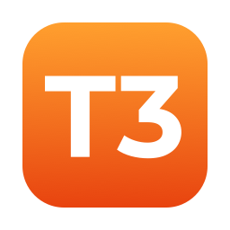

<p align="center"></p>

# Open in T3 Code

[中文](README.md)

By [@0xEcho99](https://x.com/0xEcho99)

> Click once in Finder to open the current folder in [T3 Code](https://t3.codes) and start a new thread.

This is an unofficial tool and is not affiliated with the T3 Code team.

## What it does

- **Click the toolbar button** to open the folder Finder is showing
- **Drop folders on the button** to open those folders, one or several at a time

New folders are added as projects. T3 Code is started first if it is not running.

## Requirements

| Item | Requirement |
|---|---|
| System | macOS 13 or later |
| Chip | Apple silicon or Intel |
| T3 Code | **Desktop app** v0.0.39 or later, latest recommended |

You do not need the `t3` command or Node. Windows, Linux, and setups with only the CLI or web app are not supported.

## Download

**[Download ZIP](https://github.com/Frio99/open-in-t3code/archive/refs/heads/main.zip)**

## Install

1. Unzip and move `Open in T3 Code.app` to Applications
2. Double-click it once in Applications and allow it as described below
3. Hold `⌘` and drag it from Applications to the toolbar of a Finder window

### If macOS blocks the app

The app is not signed with an Apple certificate, so macOS blocks the first launch. This is expected.

**macOS 15 and later**

1. When it is blocked, click **Done**. Do not click "Move to Trash"
2. Open **System Settings → Privacy & Security** and scroll to Security
3. Click **Open Anyway** next to Open in T3 Code and enter your password when asked

**Open Anyway** only appears for about an hour after the app is blocked. If it is missing, double-click the app again.

**macOS 14 and earlier**

Right-click the app, choose **Open**, then click **Open** again in the dialog.

**Or use Terminal**

```bash
xattr -dr com.apple.quarantine "/Applications/Open in T3 Code.app"
```

This only removes the download quarantine flag from this app. It does not turn off Gatekeeper.

### Allow Finder access

On the first click, macOS asks whether the app may control Finder. Allow it. The app only uses this to read the path of the current folder. macOS may ask again after you update the app.

## FAQ

**It opened a different folder**

A click uses the folder shown by the front Finder window, not the selected item. To open a selected folder, drop it on the button.

**"Finder access is needed"**

In System Settings → Privacy & Security → Automation, turn on Finder under Open in T3 Code.

**Recents or search results will not open**

They are not real folders. Open a specific folder first.

**"Could not open in T3 Code"**

Update T3 Code and check that it starts normally.

## Security notes

- The app makes no network requests, collects no data, and changes no T3 Code or system settings.
- New T3 Code threads default to **Full access**, so agents edit files and run commands without asking. Only open folders you trust, or change it in Settings → Threads → New threads → Permissions.

## How it works

A small native app reads the current Finder path, finds your T3 Code install, and calls its bundled `t3 app <path>`. The source is in [`src/`](src).

## Build from source

Requires Xcode Command Line Tools.

```bash
./tests/run.sh
./build.sh
```

## License

[MIT](LICENSE). The T3 wordmark in the icon comes from T3 Code, copyright T3 Tools Inc. See [third-party notices](THIRD_PARTY_NOTICES.md).
