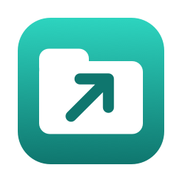

<p align="center"></p>

# Open in T3 Code

[English](README.en.md)

作者：[@0xEcho99](https://x.com/0xEcho99)

> 在访达里点一下，就在 [T3 Code](https://t3.codes) 中打开当前文件夹，直接开始新会话。

这是非官方小工具，与 T3 Code 团队无关。

## 能做什么

- **点一下工具栏按钮**：打开访达当前所在的文件夹
- **把文件夹拖到按钮上**：打开拖入的文件夹，可以一次拖多个

没加过的文件夹会自动添加成项目。T3 Code 没启动时会先启动它。

## 环境要求

| 项目 | 要求 |
|---|---|
| 系统 | macOS 13 及以上 |
| 芯片 | Apple 芯片或 Intel |
| T3 Code | **桌面版** v0.0.39 及以上，建议最新版 |

不需要安装 `t3` 命令，也不需要 Node。不支持 Windows、Linux，以及只装了命令行版或只用网页版的情况。

## 下载

**[下载 ZIP](https://github.com/Frio99/open-in-t3code/archive/refs/heads/main.zip)**

## 安装

1. 解压，把里面的 `Open in T3 Code.app` 拖进「应用程序」
2. 在「应用程序」里双击它一次，按下面的方法放行
3. 按住 `⌘`，把它从「应用程序」拖到访达窗口顶部的工具栏

### 打开时被 macOS 拦截

App 没有购买 Apple 签名，第一次打开会被拦截，这是正常现象。

**macOS 15 及以上**

1. 被拦时点 **完成**，不要点「移到废纸篓」
2. 打开 **系统设置 → 隐私与安全性**，拉到「安全性」
3. 在 Open in T3 Code 旁边点 **仍要打开**，按提示输入开机密码

「仍要打开」只在被拦后约 1 小时内出现。没看到的话，再双击一次 App。

**macOS 14 及以下**

右键点击 App，选择 **打开**，在弹窗中再点一次 **打开**。

**也可以用命令放行**

```bash
xattr -dr com.apple.quarantine "/Applications/Open in T3 Code.app"
```

这条命令只移除这个 App 的下载隔离标记，不会关闭系统的 Gatekeeper。

### 允许控制访达

第一次点击时，macOS 会询问是否允许它控制「访达」，请选择允许。它只用这个权限读取当前文件夹的路径。更新本工具后，系统可能会再问一次。

## 常见问题

**打开的不是我想要的文件夹**

点击按钮时，取的是访达最前面那个窗口所在的文件夹，不是选中的文件夹。要打开选中的文件夹，把它拖到按钮上。

**提示「需要允许控制访达」**

到「系统设置 → 隐私与安全性 → 自动化」，打开 Open in T3 Code 下面的「访达」。

**点了「最近使用」或搜索结果没法打开**

它们不是真实文件夹，先进入一个具体的文件夹。

**提示「没能在 T3 Code 中打开」**

把 T3 Code 更新到最新版，并确认它能正常启动。

## 安全说明

- 本工具不联网、不收集数据，也不修改 T3 Code 或系统的任何设置。
- T3 Code 新会话的默认权限是 **完全访问**，Agent 改文件、执行命令不会询问。只打开你信任的文件夹，或在 T3 Code 的「设置 → 会话 → 新会话 → 权限」里调整。

## 工作原理

一个很小的原生 App：读取访达当前路径，找到本机的 T3 Code，再调用它自带的 `t3 app <路径>`。源码在 [`src/`](src)。

## 从源码构建

需要 Xcode Command Line Tools。

```bash
./tests/run.sh
./build.sh
```

## 许可证

[MIT](LICENSE)
